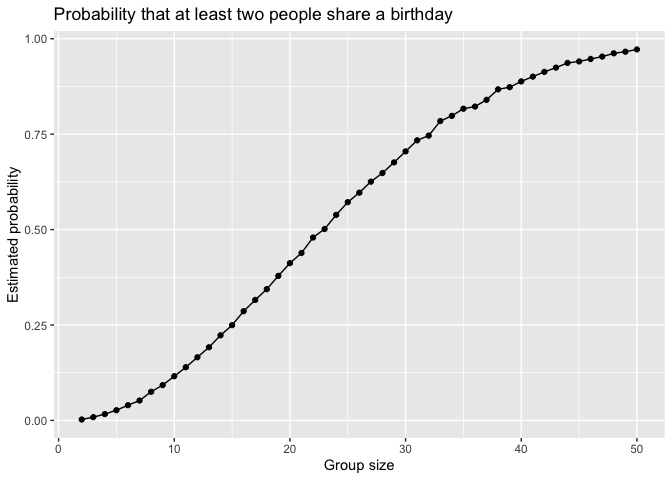
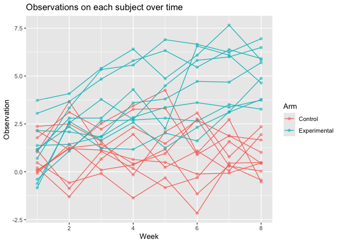
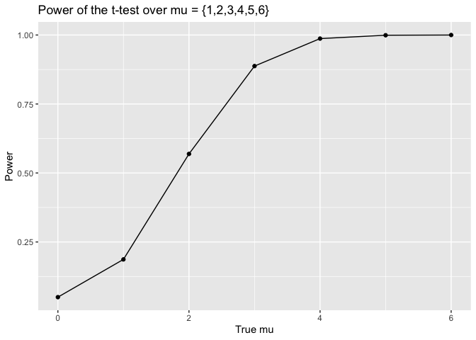
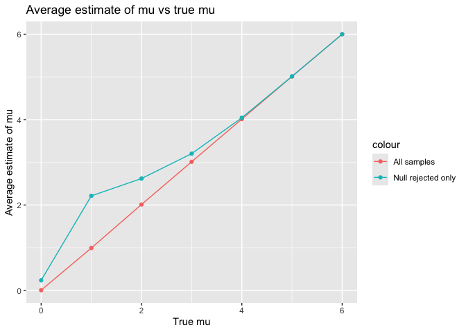

p8105_hw5_cc5604
================
Changshen Chen
2026-11-18

# Problem 1

## Writing a function that, for a fixed group size, randomly draws “birthdays” for each person

``` r
sim_birthday = function(n) {
  birthday = sample(1:365, size = n, replace = TRUE)
  duplicate = length(unique(birthday)) < n
  return(duplicate)
}
```

## Running function 10000 times for each group size between 2 and 50 (computing the probability that at least two people in the group will share a birthday by averaging across the 10000 simulation runs for each group)

``` r
library(tidyverse)
```

    ## ── Attaching core tidyverse packages ──────────────────────── tidyverse 2.0.0 ──
    ## ✔ dplyr     1.2.1     ✔ readr     2.2.0
    ## ✔ forcats   1.0.1     ✔ stringr   1.6.0
    ## ✔ ggplot2   4.0.3     ✔ tibble    3.3.1
    ## ✔ lubridate 1.9.5     ✔ tidyr     1.3.2
    ## ✔ purrr     1.2.2     
    ## ── Conflicts ────────────────────────────────────────── tidyverse_conflicts() ──
    ## ✖ dplyr::filter() masks stats::filter()
    ## ✖ dplyr::lag()    masks stats::lag()
    ## ℹ Use the conflicted package (<http://conflicted.r-lib.org/>) to force all conflicts to become errors

``` r
set.seed(1)

sim_results_df = 
  expand_grid(
    group_size = 2:50,
    iter = 1:10000
  ) |> 
  mutate(
    shared = map_lgl(group_size, sim_birthday)
  ) |> 
  group_by(group_size) |>
  summarize(
    prob_shared = mean(shared)
  )
```

## Making a plot showing the probability as a function of group size

``` r
sim_results_df |>
  ggplot(aes(x = group_size, y = prob_shared)) +
  geom_point() +
  geom_line() +
  labs(
    title = "Probability that at least two people share a birthday",
    x = "Group size",
    y = "Estimated probability"
  )
```

<!-- --> The
probability that at least two people in the group will share a birthday
forms a s-shaped curved as group size increase. The value starts at
around 0 when group size is small and rises quickly after the group size
reaches 10. It goes above 0.5 at a group size of 23. By the group size
of 50, it reaches a plateau near 1, suggesting that a shared birthday is
almost certain.

# Problem 2

## Importing the datasets

``` r
study_df =
  tibble(
    name = list.files("data/", pattern = "\\.csv$")
  )

study_df =
  study_df |>
  mutate(
    data = map(str_c("data/", name), read_csv)
  )|>
  unnest(data)
```

## Tidying the datasets

``` r
study_df =
  study_df |>
  janitor::clean_names()|>
  mutate(
    name = str_remove(name, "\\.csv$")
  ) |>
  separate(name, into = c("arm", "subject_id"), sep = "_") |>
  mutate(
    arm = case_match(
      arm,
      "con" ~ "Control",
      "exp" ~ "Experimental"
   )
  )|>
  mutate(
    subject_id = str_c(arm, "_", subject_id)
  )|>
  pivot_longer(
    cols = starts_with("week_"),
    names_to = "week",
    names_prefix = "week_",
    values_to = "observation"
  ) |>
  mutate(
    week = as.numeric(week)
  )
```

    ## Warning: There was 1 warning in `mutate()`.
    ## ℹ In argument: `arm = case_match(arm, "con" ~ "Control", "exp" ~
    ##   "Experimental")`.
    ## Caused by warning:
    ## ! `case_match()` was deprecated in dplyr 1.2.0.
    ## ℹ Please use `recode_values()` instead.

``` r
study_df
```

    ## # A tibble: 160 × 4
    ##    arm     subject_id  week observation
    ##    <chr>   <chr>      <dbl>       <dbl>
    ##  1 Control Control_01     1        0.2 
    ##  2 Control Control_01     2       -1.31
    ##  3 Control Control_01     3        0.66
    ##  4 Control Control_01     4        1.96
    ##  5 Control Control_01     5        0.23
    ##  6 Control Control_01     6        1.09
    ##  7 Control Control_01     7        0.05
    ##  8 Control Control_01     8        1.94
    ##  9 Control Control_02     1        1.13
    ## 10 Control Control_02     2       -0.88
    ## # ℹ 150 more rows

## Spaghetti plot showing observations on each subject over time

``` r
study_df |>
  ggplot(aes(x = week, y = observation, group = subject_id, color = arm)) +
  geom_point(alpha = 0.5) +
  geom_line() +
  labs(
    title = "Observations on each subject over time",
    x = "Week",
    y = "Observation",
    color = "Arm"
  )
```

<!-- -->

Both arms start at similar observed values at week 1. As time passes,
the observed values for subjects in the experimental arm demonstrate a
general trend of increase. In contrast, the observed values for subjects
in the control arm stays relatively unchanged. This trend suggests that
the experiment is associated with an increase in the observed outcome
over time.

# Problem 3

## Writing a function for one simulated dataset

``` r
sim_t_test = function(mu, n = 30, sigma = 5) {
  x = rnorm(n, mean = mu, sd = sigma)
  t.test(x, mu = 0) |>
    broom::tidy() |>
    select(mu_hat = estimate, p_value = p.value)
}
```

## Generating 5000 datasets for 𝜇={1,2,3,4,5,6}

``` r
sim_results =
  expand_grid(
    true_mu = 0:6,
    iter = 1:5000
  ) |>
  mutate(
    test_result = map(true_mu, sim_t_test)
  ) |>
  unnest(test_result) |>
  mutate(
    reject = p_value < 0.05
  )
```

## Making a plot showing the proportion of times the null was rejected (the power of the test) on the y axis and the true value of 𝜇 on the x axis

``` r
power_df =
  sim_results |>
  group_by(true_mu) |>
  summarize(
    power = mean(reject)
  )

power_df |>
  ggplot(aes(x = true_mu, y = power)) +
  geom_point() +
  geom_line() +
  labs(
    title = "Power of the t-test over mu = {1,2,3,4,5,6}",
    x = "True mu",
    y = "Power"
  )
```

<!-- -->

The plot shows that power increases as the effect size increases
(positive correlation). The s-shaped curve suggests that power starts at
near 0 when the effect size is small. As effect size increases, power
rises quickly and reaches the plateau at around 1 after the true mu
exceeds 4.

## Making a plot showing average estimate of mu vs true mu

``` r
avg_est_df =
  sim_results |>
  group_by(true_mu) |>
  summarize(
    avg_all = mean(mu_hat),
    avg_rejected = mean(mu_hat[reject])
  )

avg_est_df |>
  ggplot(aes(x = true_mu)) +
  geom_line(aes(y = avg_all, color = "All samples")) +
  geom_point(aes(y = avg_all, color = "All samples")) +
  geom_line(aes(y = avg_rejected, color = "Null rejected only")) +
  geom_point(aes(y = avg_rejected, color = "Null rejected only")) +
  labs(
    title = "Average estimate of mu vs true mu",
    x = "True mu",
    y = "Average estimate of mu",
  )
```

<!-- -->

From the plot, the sample average of 𝜇̂ across tests for which the null
is rejected is not equal to the true value of 𝜇.For the samples in which
the null was rejected, the average estimate is too high when mu is
small. This is because that conditioning on rejecting the null
hypothesis filters out samples where 𝜇̂ happened to be close to zero due
to random sampling variation. Therefore, when the true mu is small, only
samples that happened to get a large estimate are rejected, so their
average is biased upward.
